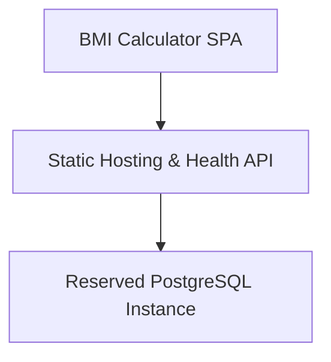
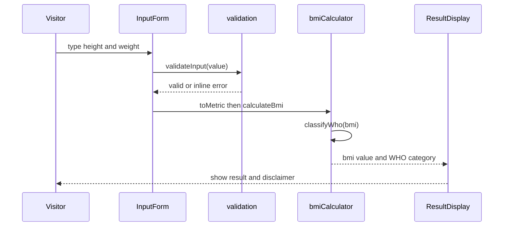
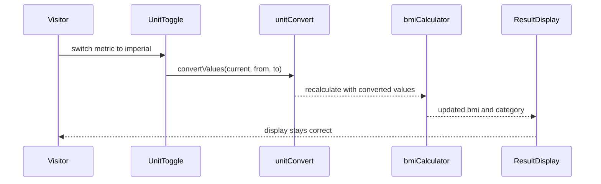
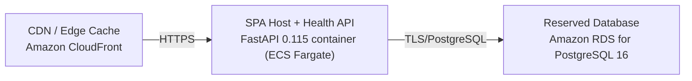

# Architecture

> Maintained by QuorQ AI SDLC. Text between `sdlc:auto` markers is regenerated; anything outside them is yours and is kept.

<!-- sdlc:auto:start narrative -->
## Overview

### ARCH-001 · approved · source: architecture:summary

Overall architecture approved as v1: a single-page, client-side BMI calculator with a minimal backend and an unused reserved database.

BMI is designed as a lightweight, free, anonymous web tool: one responsive React 19 page where a visitor enters height and weight, toggles metric/imperial units, and instantly sees BMI value and WHO adult category. All arithmetic, validation, unit conversion and category assignment happen in the browser; nothing is transmitted or saved, satisfying the stated privacy requirement. A small FastAPI 0.115 service hosts the static page and exposes a health-check endpoint, deployed on AWS for low cost at low traffic and automatic absorption of spikes. PostgreSQL 16 is provisioned per the approved stack but sits effectively unused today, reserved only for possible future anonymous usage counts.

- ⚠ Input does not map individual components or decisions to specific requirement ids (US-001..US-008); traceability from this architecture to those requirements could not be confirmed beyond the implicit privacy/no-persistence framing.

### ARCH-COMP-FRONTEND · approved · source: architecture:components:frontend

BMI Calculator SPA built in React 19 is the entire product: a single responsive page handling entry, validation, unit conversion, calculation, and category display.

Single responsive page covering: height/weight entry, inline validation, metric/imperial toggle and conversion, in-browser BMI calculation, WHO category assignment, and a not-medical-advice disclaimer. All logic runs client-side so no health data leaves the browser.

- ⚠ No explicit requirement id linkage given in input for this component.

### ARCH-COMP-BACKEND · approved · source: architecture:components:backend

FastAPI 0.115 service exists only to serve the static SPA reliably and expose a health check -- it performs no BMI logic and persists nothing.

Serves the built SPA assets to anonymous visitors and exposes a small health-check endpoint. No BMI calculation and no server-side persistence of any entered values.

- ⚠ No explicit requirement id linkage given in input for this component.

### ARCH-COMP-DATABASE · approved · source: architecture:components:database

A PostgreSQL 16 instance is provisioned per the approved stack but is currently unused and off the calculation path.

Reserved as future-proofing only, e.g. for optional anonymous usage counts later. Holds no personal or health data today and is not involved in the current BMI calculation flow.

- ⚠ No concrete plan or requirement was provided for when/how this database would actually be used; its purpose is speculative future-proofing only.

### ARCH-CP-001 · approved · source: architecture:critical_paths:In-browser BMI calculation

Core critical path: visitor enters height/weight and sees BMI and WHO category instantly, entirely client-side.

Visitor types height and weight; the app validates input, normalises to metric using the selected unit system, computes BMI = kg / m^2, maps the result to the WHO adult category, and renders it live with no server round-trip.

### ARCH-CP-002 · approved · source: architecture:critical_paths:Unit system switch

Critical path for switching between metric and imperial units without losing correctness or reloading.

When the visitor toggles between metric and imperial, existing valid values are converted (or fields re-presented) so the displayed BMI stays correct without a page reload.

### ARCH-EP-001 · approved · source: architecture:endpoints:GET /health

Health-check endpoint used by the load balancer/hosting service to verify liveness and readiness.

GET /health -- Liveness/readiness check for the hosting service and load balancer.

### ARCH-EP-002 · approved · source: architecture:endpoints:GET /

Root endpoint serves the built React SPA to anonymous visitors.

GET / -- Serves the built React SPA (index.html and static assets) to anonymous visitors.

### ARCH-DEPLOY-001 · approved · source: architecture:deployment_nodes

Deployment topology: CloudFront edge cache in front of an ECS Fargate FastAPI container, with a reserved RDS PostgreSQL instance.

Three deployment nodes: (1) CDN / Edge Cache -- Amazon CloudFront, AWS managed edge; (2) SPA Host + Health API -- FastAPI 0.115 container on ECS Fargate, running Python 3.12 / Uvicorn; (3) Reserved Database -- Amazon RDS for PostgreSQL 16.

### ARCH-TECH-FRONTEND · approved · source: architecture:technology_decisions:Frontend

React 19 chosen for the frontend over Vue or Svelte to handle live recalculation, unit toggling, and inline validation.

Decision: React 19 (alternatives considered: Vue, Svelte). Rationale: the whole product is one interactive page; React 19 handles live in-browser recalculation, the unit toggle, and inline validation cleanly, and renders a responsive layout for phones and desktops. All BMI arithmetic runs client-side here, so nothing is saved or transmitted.

### ARCH-TECH-BACKEND · approved · source: architecture:technology_decisions:Backend

FastAPI 0.115 chosen for the backend over Flask or Node/Express to serve the static SPA and health check, with room to grow.

Decision: FastAPI 0.115 (alternatives considered: Flask, Node/Express). Rationale: serves the static SPA and a small health-check endpoint reliably to anonymous visitors, with room to add a server-side calculation endpoint later without changing the stack.

### ARCH-TECH-DATABASE · approved · source: architecture:technology_decisions:Database

PostgreSQL 16 chosen over having no database at all, purely as future-proofing.

Decision: PostgreSQL 16 (alternatives considered: No database). Rationale: provisioned as future-proofing for possible anonymous usage counts; the product stores no personal or health data today, so it sits effectively unused.

- ⚠ No requirement currently justifies the database's existence; its value is purely speculative/future-facing per the input.

### ARCH-TECH-CLOUD · approved · source: architecture:technology_decisions:Cloud

AWS chosen over GCP or Azure to keep hosting cheap at low traffic while auto-scaling for spikes, addressing NFR-005.

Decision: AWS (alternatives considered: GCP, Azure). Rationale: CloudFront plus an auto-scaling FastAPI host serves the responsive page cheaply worldwide and absorbs sudden traffic spikes without manual intervention (NFR-005), keeping the bill tiny at low traffic.

**Related:** NFR-005

- ⚠ NFR-005 is referenced by the architecture input but is not among the known requirement keys (US-001..US-008) provided, so its source/origin outside this architecture doc could not be verified.
<!-- sdlc:auto:end narrative -->

<!-- sdlc:auto:start building-blocks -->
## Building Block View

| ID | Name | Technology | Responsibility | Depends on |
|---|---|---|---|---|
| frontend | BMI Calculator SPA | React 19 | Single responsive page: height/weight entry, inline validation, metric/imperial toggle and conversion, in-browser BMI calculation, WHO category assignment, and the not-medical-advice disclaimer. All logic runs client-side so no health data leaves the browser. | backend |
| backend | Static Hosting & Health API | FastAPI 0.115 | Serves the built SPA assets reliably to anonymous visitors and exposes a small health-check endpoint. No BMI calculation and no persistence of any entered values server-side. | database |
| database | Reserved PostgreSQL Instance | PostgreSQL 16 | Provisioned per the approved stack as future-proofing only (e.g. optional anonymous usage counts later). Holds no personal or health data today and is not on the calculation path. | — |

<!-- sdlc:auto:end building-blocks -->

<!-- sdlc:auto:start runtime -->
## Runtime View

### In-browser BMI calculation

Visitor types height and weight; the app validates input, normalises to metric using the selected unit system, computes BMI = kg / m^2, maps to the WHO adult category, and renders the result live with no server round-trip.

- **Components:** frontend
- **Modules:** InputForm, UnitToggle, bmiCalculator, validation, whoCategory, ResultDisplay
- **Key functions:** validateInput(value, field), toMetric(height, weight, unitSystem), calculateBmi(weightKg, heightM), classifyWho(bmi), onInputChange(field, value)

### Unit system switch

When the visitor toggles between metric and imperial, existing valid values are converted (or fields re-presented) so the displayed BMI stays correct without a reload.

- **Components:** frontend
- **Modules:** UnitToggle, unitConvert, bmiCalculator, ResultDisplay
- **Key functions:** onUnitChange(newSystem), convertValues(values, fromSystem, toSystem), recalculate()

<!-- sdlc:auto:end runtime -->

<!-- sdlc:auto:start deployment-view -->
## Deployment View

| Name | Service | Runtime | Scaling | Environment |
|---|---|---|---|---|
| CDN / Edge Cache | Amazon CloudFront | AWS managed edge | Global edge caching, absorbs traffic spikes automatically | dev |
| SPA Host + Health API | FastAPI 0.115 container (ECS Fargate) | Python 3.12 / Uvicorn | Auto-scaling on request count, scales to near-zero at low traffic | dev |
| Reserved Database | Amazon RDS for PostgreSQL 16 | PostgreSQL 16 | Single small instance, idle; reserved for future use | dev |

| Source | Target | Protocol |
|---|---|---|
| CDN / Edge Cache | SPA Host + Health API | HTTPS |
| SPA Host + Health API | Reserved Database | TLS/PostgreSQL |

<!-- sdlc:auto:end deployment-view -->

<!-- sdlc:auto:start decisions -->
## Architecture Decisions

| Layer | Choice | ADR |
|---|---|---|
| Frontend | React 19 | [ADR-0001](adr/frontend.md) |
| Backend | FastAPI 0.115 | [ADR-0002](adr/backend.md) |
| Database | PostgreSQL 16 | [ADR-0003](adr/database.md) |
| Cloud | AWS | [ADR-0004](adr/cloud.md) |
<!-- sdlc:auto:end decisions -->

<!-- sdlc:auto:start links -->
## Related Documents

- [Data Model](data-model.md)
- [API Specification](api/openapi.yaml)
- [Architecture Decision Records](adr/README.md)
<!-- sdlc:auto:end links -->
